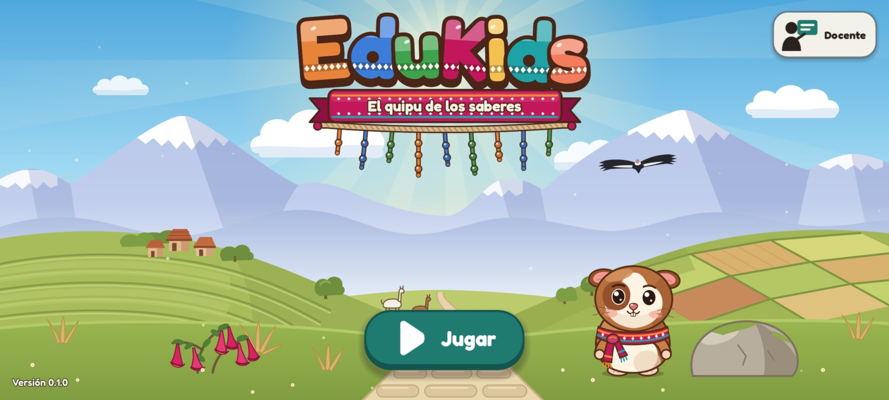

# EduKids: juego para Android (Godot)

Proyecto del videojuego en **Godot 4.7.2** con GDScript, 2D y renderizador Compatibility (OpenGL ES 3.0). Sigue **Clean Architecture** ([ADR-010](../docs/01-analisis-de-sistema/decisiones/ADR-010-clean-architecture.md)): las reglas del juego viven en el dominio y no dependen de Godot, de la base de datos ni de la red.



## Requisitos

| Herramienta | Versión | Para qué |
| --- | --- | --- |
| Godot | 4.7.2 estable (sin .NET) | Editor y ejecución |
| Plantillas de exportación | 4.7.2 (Android) | Generar el APK |
| Android SDK | build-tools 34 o superior | Firmar el APK |
| JDK | 17 | Herramientas de Android |
| GdUnit4 | 6.2.3 (incluido en `addons/`) | Pruebas |

En macOS: `brew install --cask godot`. Las plantillas se instalan desde el editor en **Editor → Administrar plantillas de exportación**.

## Ejecutar

1. Abre `android/project.godot` con Godot.
2. Presiona **F5**. La pantalla de inicio se ve en 1280 × 800 y se adapta a otras proporciones.

Modo demostración (toca Jugar y avanza el diálogo solo, útil para grabar):

```bash
godot --path android -- --demo
```

Grabar un video con el Movie Maker de Godot:

```bash
godot --path android --write-movie builds/demo.avi --fixed-fps 30 --quit-after 660 -- --demo
```

## Pruebas

Desde `android/`:

```bash
godot --headless --path . --import
```

```bash
godot --headless --path . -s -d --remote-debug tcp://127.0.0.1:0 res://addons/gdUnit4/bin/GdUnitCmdTool.gd --ignoreHeadlessMode -a res://tests -c
```

```bash
bash tests/architecture/check_dependencies.sh
```

| Carpeta | Qué prueba |
| --- | --- |
| `tests/unit/domain` | Medidor de peligro (RN-13), estrellas (RN-11), escala AD/A/B/C (RN-12) y escenas narrativas |
| `tests/unit/application` | Casos de uso con repositorios falsos |
| `tests/unit/presentation` | Presentadores y modelos de vista |
| `tests/integration` | Lectura de JSON, reloj, aleatoriedad e identificadores |
| `tests/architecture` | Regla de dependencias entre capas (RNF-15, CA-20) |

El CI ([`.github/workflows/android.yml`](../.github/workflows/android.yml)) ejecuta la verificación de capas y las pruebas en cada cambio dentro de `android/`. Los reportes de GdUnit4 se guardan en `reports/` (ignorado por Git).

## Exportar el APK de prueba

```bash
godot --headless --path android --export-debug "Android" builds/edukids-debug.apk
```

```bash
adb install -r android/builds/edukids-debug.apk
```

- El editor crea su propio keystore de depuración la primera vez que se abre. Ningún keystore va al repositorio.
- Para una versión de publicación se usan las variables `GODOT_ANDROID_KEYSTORE_RELEASE_PATH`, `GODOT_ANDROID_KEYSTORE_RELEASE_USER` y `GODOT_ANDROID_KEYSTORE_RELEASE_PASSWORD`.
- `builds/` está ignorada por Git.

## Organización

```text
android/
├── src/
│   ├── domain/          1. Reglas: DangerMeter, StarRule, CnebGradeScale, StoryScene, Result
│   ├── application/     2. Casos de uso (GetStoryScene), puertos y DTO
│   ├── infrastructure/  3. Adaptadores de salida: JSON, reloj, aleatoriedad, UUID
│   ├── presentation/    3. Presentadores y modelos de vista
│   └── main/            Raíz de composición (autoload) y navegador
├── scenes/              4. Vistas: pantalla de inicio, globo de diálogo, Quwi y cóndor
├── assets/              Arte importado, fuentes y tema de la interfaz
├── content/story/       Escenas narrativas del juego base (JSON)
├── art-src/             Fuentes del arte (SVG maestros); Godot no las importa
├── tools/art/           Herramientas del flujo de arte
├── tests/               Pruebas y verificación de capas
└── addons/gdUnit4/      Pruebas (versión fijada)
```

El detalle está en la [estructura del repositorio](../docs/03-diseno-de-software/estructura-del-repositorio.md).

## Flujo de arte

| Recurso | Fuente | Cómo llega al juego |
| --- | --- | --- |
| Fondos por capas | `assets/art/backgrounds/*.svg` | Godot importa el SVG a 1,5× |
| Interfaz e iconos | `assets/art/ui/*.svg` | Godot importa el SVG a 2× |
| Personajes por piezas | `art-src/characters/<personaje>.svg` y `<personaje>.rig.json` | `tools/art/build_cutout_rig.gd` rasteriza cada pieza a 2×, arma un atlas y genera la escena del rig |
| Letras del logotipo | Fredoka Bold (OFL) | `art-src/tools/make_logo_letters.py` genera una letra por SVG y su escena |
| Ícono de la app | `icon.svg` y `art-src/icons/` | PNG de 192 y 432 px para Android |

Reconstruir el rig de Quwi después de editar su SVG:

```bash
godot --headless --path android -s res://tools/art/build_cutout_rig.gd -- res://art-src/characters/quwi.rig.json
```

Regenerar las letras del logotipo (requiere `pip install fonttools`):

```bash
python3 android/art-src/tools/make_logo_letters.py
```

Cada grupo `part_*` del SVG maestro es una pieza; el archivo `.rig.json` define la jerarquía y el pivote de cada una. La escena del rig se genera y no se edita a mano; la animación vive en el script del personaje.

## Mediciones del Sprint 2

| Medida | Resultado | Meta |
| --- | --- | --- |
| Tamaño del APK de depuración (arm64-v8a y armeabi-v7a) | 59 MB | 150 MB o menos (RNF) |
| Memoria en el emulador Android 17 (PSS) | 110 MB | 400 MB o menos (RNF) |
| CPU por cuadro de la pantalla de inicio (Mac, Movie Maker) | 1,7 ms | Cuadros de 33 ms para 30 fps |
| Atlas de Quwi | 1024 × 624 px, 17 piezas | 2048 × 2048 px o menos |

Falta medir en la tablet real del piloto: arranque, fps y memoria.

## Panel de medición

En la pantalla de inicio, tres toques seguidos sobre el texto de la versión abren un panel con el modelo, Android, la arquitectura, la GPU, la memoria, los cuadros por segundo, el tiempo de arranque y el estado de SQLite. Una captura de ese panel en la tablet real cierra la medición del Sprint 2. También se abre con `godot --path android -- --diagnostics`.

## Licencias de terceros

| Recurso | Licencia |
| --- | --- |
| Fredoka y Andika (`assets/fonts/`) | SIL Open Font License 1.1 (incluida en la carpeta) |
| GdUnit4 (`addons/gdUnit4/`) | MIT (incluida en la carpeta) |
| godot-sqlite 4.9 (`addons/godot-sqlite/`) | MIT (incluida en la carpeta) |
| Godot Engine | MIT |
