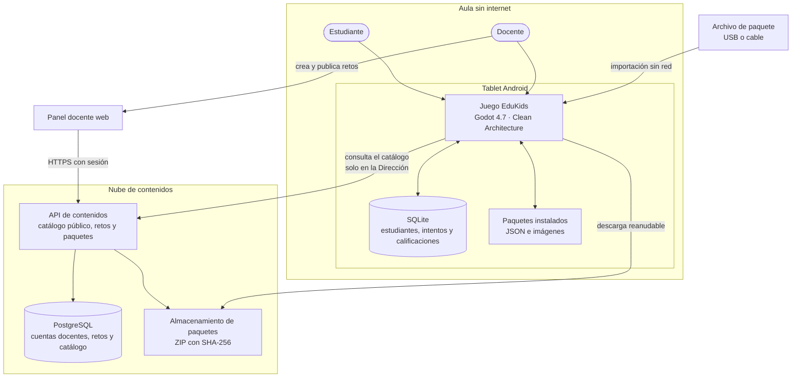

# Arquitectura inicial

EduKids se ejecuta en tablets Android sin internet. La nube solo distribuye contenidos y permite a los docentes crear retos. Los estudiantes, intentos, respuestas y calificaciones permanecen en la tablet.

**Regla de privacidad:** ningún dato de estudiantes sale de la tablet hacia la nube. La única salida es la exportación de reportes que hace el docente.
