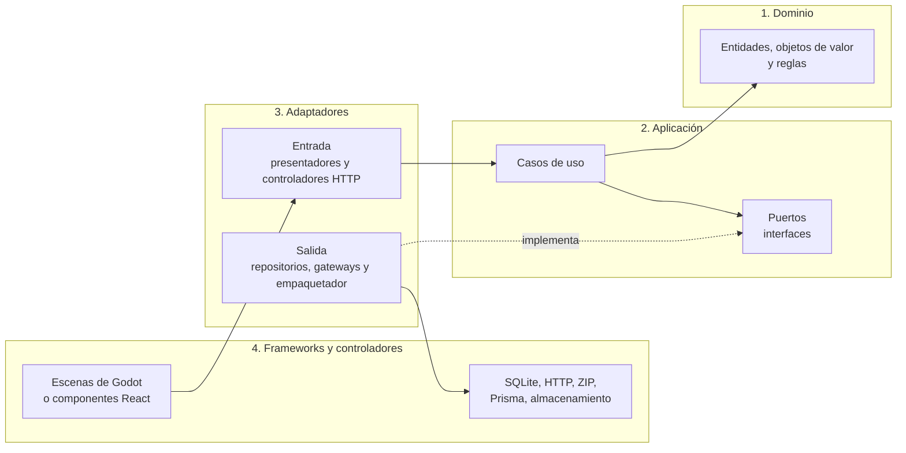

# Clean Architecture

EduKids aplica Clean Architecture en sus tres aplicaciones: el juego (`android/`), el backend (`backend/`) y el panel docente (`web/`). Esta página define las capas, la regla de dependencias y cómo se aplica en cada tecnología. La decisión está registrada en [ADR-010](../01-analisis-de-sistema/decisiones/ADR-010-clean-architecture.md).

## Capas



Las flechas indican "depende de". **Regla de dependencias:** el código de una capa solo conoce capas más internas. El dominio no conoce a nadie; los casos de uso solo conocen el dominio y sus propios puertos; los adaptadores implementan esos puertos.

| Capa | Responsabilidad | Ejemplos en EduKids |
| --- | --- | --- |
| 1. Dominio | Reglas que serían ciertas aunque no existiera la aplicación | Corregir una respuesta, medidor de peligro, vidas, estrellas, escala AD/A/B/C, intentos, validez de un manifiesto |
| 2. Aplicación | Orquestar una acción del usuario y declarar lo que necesita del exterior | Responder una pregunta, rendir el desafío final, instalar un paquete, publicar un reto |
| 3. Adaptadores | Traducir entre los casos de uso y el mundo exterior | Presentador de un nivel, controlador HTTP del catálogo, repositorio SQLite, cliente del catálogo |
| 4. Frameworks | Herramientas que se pueden reemplazar | Godot, godot-sqlite, Fastify, Prisma, React, almacenamiento S3 |

## Reglas de trabajo

1. **Puertos en la aplicación:** cada necesidad externa de un caso de uso (guardar intentos, leer paquetes, descargar, medir el tiempo) es un puerto definido en `application/ports`. La infraestructura lo implementa.
2. **Objetos de petición y respuesta:** los casos de uso reciben y devuelven objetos simples (DTO). Las escenas nunca reciben entidades del dominio.
3. **Vistas humildes:** una escena de Godot o un componente React solo muestra datos y reenvía eventos a su presentador. No tiene reglas.
4. **Inyección de dependencias:** las dependencias llegan por el constructor (`_init`) o por `setup()`. El dominio y la aplicación nunca buscan servicios globales.
5. **Raíz de composición:** las clases concretas se crean y conectan en un solo lugar por aplicación (`main/`).
6. **Determinismo:** el reloj (`Clock`), los identificadores (`IdGenerator`) y la aleatoriedad (`RandomSource`) son puertos, para que las pruebas den siempre el mismo resultado.
7. **Errores explícitos:** el dominio y los casos de uso devuelven resultados con su error; no dependen de `push_error` ni de excepciones del framework.

## Aplicación en el juego (Godot)

| Capa | Carpeta en `android/` | Puede usar | No puede usar |
| --- | --- | --- | --- |
| Dominio | `src/domain/` | GDScript básico: `RefCounted`, tipos, `Array`, `Dictionary` | `Node`, escenas, `get_tree()`, `FileAccess`, `DirAccess`, `HTTPRequest`, SQLite, autoloads |
| Aplicación | `src/application/` | Dominio | Lo mismo que el dominio y cualquier adaptador concreto |
| Adaptadores de entrada | `src/presentation/` | Aplicación y tipos del dominio | SQLite, red y archivos |
| Adaptadores de salida | `src/infrastructure/` | Puertos, dominio, API de Godot y plugins | Escenas y presentadores |
| Frameworks (vistas) | `scenes/`, `assets/`, `addons/` | Presentadores inyectados | Casos de uso, repositorios o SQLite de forma directa |
| Composición | `src/main/` | Todo | — |

### Cómo se ve en GDScript

Un **puerto** es una clase base abstracta (sintaxis disponible desde Godot 4.5):

```gdscript
# src/application/ports/attempt_repository.gd
@abstract class_name AttemptRepository
extends RefCounted

@abstract func save_answer(attempt_id: String, answer: Answer) -> void
@abstract func close_attempt(attempt: Attempt) -> void
```

Un **caso de uso** recibe sus puertos por el constructor y no conoce SQLite:

```gdscript
# src/application/use_cases/play/submit_answer.gd
class_name SubmitAnswer
extends RefCounted

var _sessions: LevelSessionStore
var _attempts: AttemptRepository
var _clock: Clock

func _init(sessions: LevelSessionStore, attempts: AttemptRepository, clock: Clock) -> void:
	_sessions = sessions
	_attempts = attempts
	_clock = clock

func execute(request: SubmitAnswerRequest) -> SubmitAnswerResponse:
	var session: LevelSession = _sessions.get_active(request.attempt_id)
	var outcome: AnswerOutcome = session.answer(request.item_id, request.value)
	_attempts.save_answer(request.attempt_id, outcome.to_answer(_clock.now()))
	return SubmitAnswerResponse.from_outcome(outcome, session)
```

La **raíz de composición** es el único lugar que conoce las clases concretas:

```gdscript
# src/main/composition_root.gd (autoload)
func _ready() -> void:
	var db := SqliteDatabase.open("user://edukids.db")
	var attempts := SqliteAttemptRepository.new(db)
	var sessions := InMemoryLevelSessionStore.new()
	submit_answer = SubmitAnswer.new(sessions, attempts, SystemClock.new())
```

El **navegador** crea cada escena y le inyecta su presentador antes de mostrarla, así la escena nunca busca dependencias:

```gdscript
# src/main/navigator.gd
func open_level(level_id: StringName) -> void:
	var view: LevelView = LEVEL_SCENE.instantiate()
	view.setup(LevelPresenter.new(_root.start_level, _root.submit_answer))
	_show(view)
```

### Reglas del juego en el dominio

La animación vive en las escenas, pero las **reglas** viven en el dominio. Por ejemplo, `LevelSession` decide si una respuesta es correcta, mueve el medidor de peligro, descuenta vidas y calcula las estrellas. La escena solo traduce el resultado a una animación: el avatar avanza o Atoq se acerca. Así, las reglas RN-11, RN-13 y RN-14 se prueban sin abrir Godot.

## Aplicación en el backend (Node.js y TypeScript)

| Capa | Carpeta en `backend/` | Contenido |
| --- | --- | --- |
| Dominio | `src/domain/` | `TeacherAccount`, `TeacherCode`, `Challenge`, `ChallengeItem`, `Package` y las reglas de validación del formato de paquete |
| Aplicación | `src/application/` | Casos de uso (`ListCatalog`, `PublishChallenge`, `PublishOfficialModule`, `RegisterTeacher`, `Login`) y puertos (`ChallengeRepository`, `PackageStorage`, `PackageBuilder`, `PasswordHasher`, `TokenService`) |
| Adaptadores de entrada | `src/interfaces/http/` | Rutas de Fastify, esquemas Zod y presentadores JSON |
| Adaptadores de salida | `src/infrastructure/` | Repositorios Prisma, almacenamiento S3, ZIP y SHA-256, hash de contraseñas y tokens |
| Composición | `src/main/` | Conexión de dependencias y arranque del servidor |

## Aplicación en el panel (React y TypeScript)

| Capa | Carpeta en `web/` | Contenido |
| --- | --- | --- |
| Dominio | `src/domain/` | Modelo del reto y sus validaciones (las mismas reglas del formato de paquete) |
| Aplicación | `src/application/` | Casos de uso del panel: crear, editar, previsualizar y publicar un reto |
| Infraestructura | `src/infrastructure/` | Cliente HTTP de la API y conversión de PDF a imágenes con pdf.js |
| Interfaz | `src/ui/` | Páginas y componentes React |

## Verificación automática

El CI ejecuta una verificación de dependencias en cada pull request (requisito RNF-15, criterio CA-20):

- En el juego, un script busca dentro de `src/domain/` y `src/application/` referencias prohibidas: `extends Node`, `get_tree(`, `FileAccess`, `DirAccess`, `HTTPRequest`, `SQLite`, rutas `res://scenes/`, `res://src/infrastructure/` y `res://src/presentation/`.
- En TypeScript, una regla de ESLint de importaciones restringidas impide que `domain/` y `application/` importen `infrastructure/`, `interfaces/`, `ui/` o los frameworks.

## Errores que se deben evitar

- Una escena que abre la base de datos o hace una petición HTTP.
- Un caso de uso que llama a `get_tree()` o instancia una escena.
- Un autoload que guarda el progreso del estudiante como estado global.
- Reglas del juego escritas dentro de las animaciones o de las señales de la interfaz.
- Entidades del dominio que se envían tal cual a la vista o a la respuesta HTTP.
