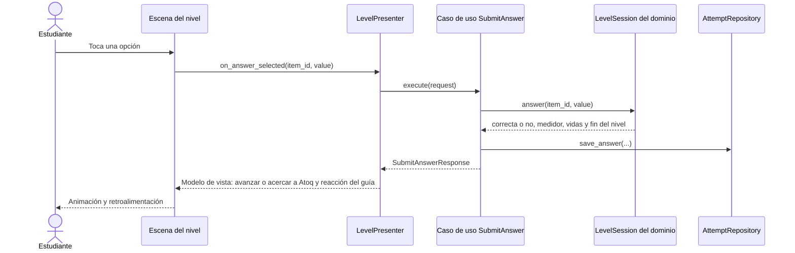
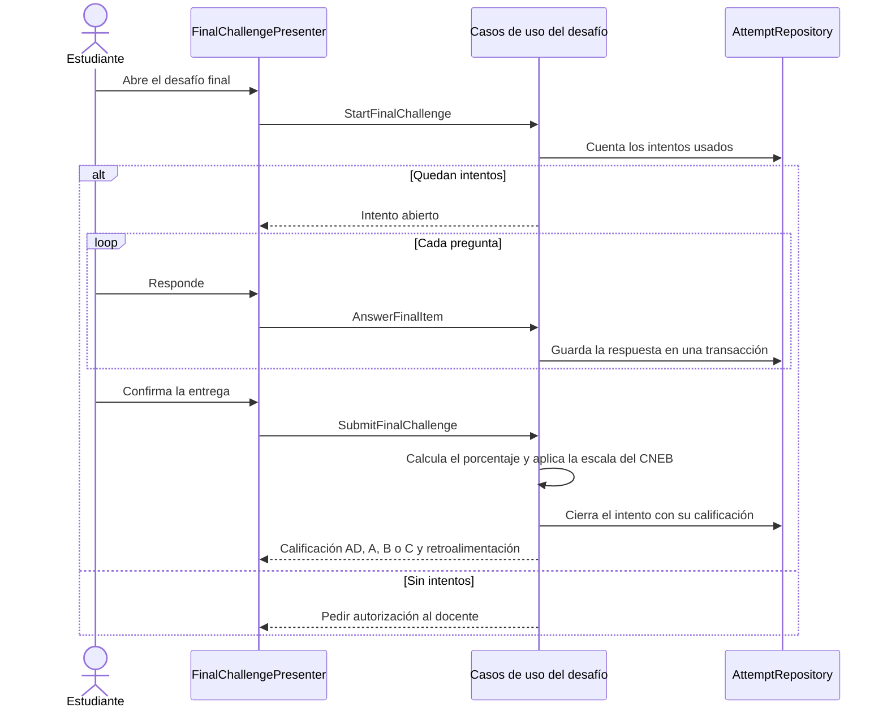
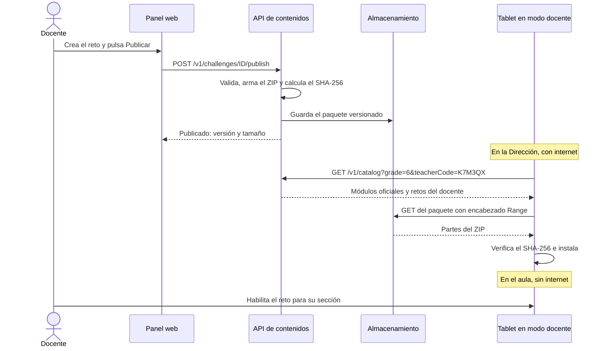
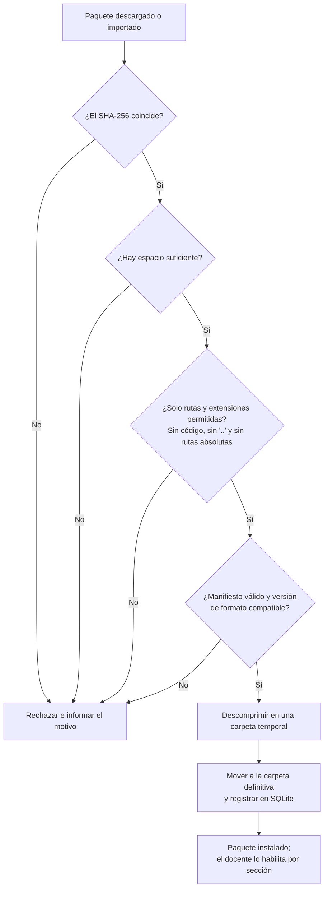

# Flujos principales

## 1. Jugar un nivel de persecución

La escena no decide nada: el caso de uso aplica las reglas del dominio y la escena solo anima el resultado.

Al terminar, el caso de uso `FinishLevel` calcula las estrellas (RN-11), otorga las recompensas y cierra el intento. Si las vidas llegan a cero, el resultado es game over y el estudiante puede reintentar (RN-14).

## 2. Rendir el desafío final

## 3. Publicar un reto y llevarlo a la tablet

## 4. Instalar un paquete

El mismo flujo se usa para un paquete descargado y para uno importado por USB.

