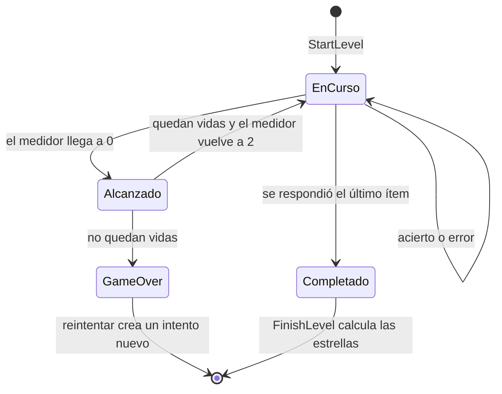
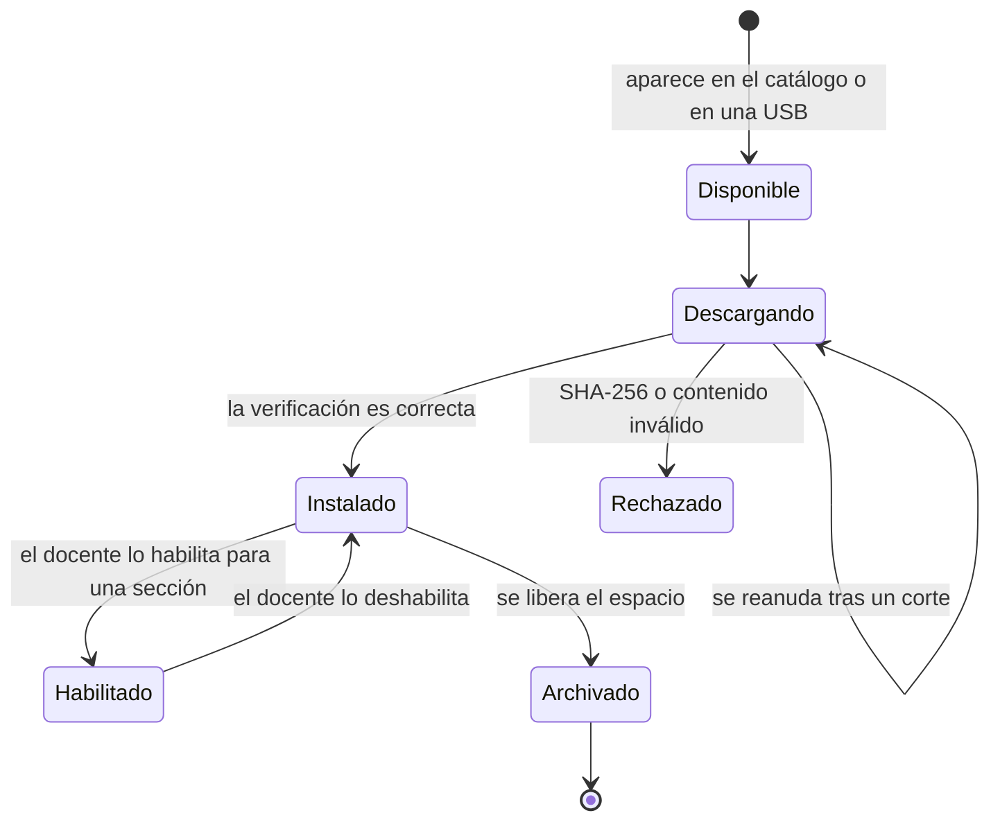

# Diseño interno de módulos

Componentes del juego con sus casos de uso, sus puertos y las reglas del dominio que usan. Los nombres están en inglés, como en el código.

## Componentes del juego

| Componente | Casos de uso | Reglas del dominio | Puertos |
| --- | --- | --- | --- |
| Aula e identidad | `ConfigureInstitution`, `GetClassroom`, `UnlockTeacherMode`, `RegisterStudent`, `UpdateStudent`, `SetStudentActive`, `ResetStudentPin`, `LoginStudent`, `ListStudents`, `GetStudentProfile`, `CustomizeAvatar`, `SuggestPin`, `SuggestAvatar` | `Pin`, `PinLockout` (bloqueo tras 5 fallos), `PersonName`, `TeacherCode`, `Avatar` | `InstitutionRepository`, `StudentRepository`, `PinHasher`, `Clock`, `IdGenerator`, `RandomSource` |
| Paquetes | `FetchCatalog`, `DownloadPackage`, `InstallPackage`, `ImportPackageFile`, `ReleasePackage`, `EnablePackage` | Validación del manifiesto y del contenido | `CatalogGateway`, `PackageDownloader`, `PackageArchive`, `PackageRepository`, `FileImporter` |
| Mapa | `GetChapterMap` (capítulo, paradas y un sendero por área) | `Chapter` (paradas en orden), `TrailRule` (RN-18) | `PackageStore`, `AttemptRepository` |
| Contenidos | `GetStopContent`, `OpenTheory`, `OpenReading` | — | `PackageStore`, `ProgressRepository` |
| Juego | `StartLevel`, `SubmitAnswer`, `RequestHint`, `ContinueLevel`, `FinishLevel`, `RegisterBundledPackages` | `LevelSession`, `DangerMeter`, `StarRule`, `EvaluatorRegistry` y un evaluador por tipo | `PackageStore`, `PackageRepository`, `AttemptRepository`, `LevelSessionStore`, `Clock`, `IdGenerator`, `RandomSource` |
| Desafío final | Los mismos casos de uso del juego (la sesión cambia sus reglas con `kind: final`); después `AuthorizeExtraAttempt` | `LevelSession` en modo final, `CnebGradeScale`, `TrailRule.attempts_left` | `AttemptRepository`, `SettingsRepository`, `Clock` |
| Recompensas | `GrantRewards`, `GetCollection` (los accesorios de RF-32 amplían `CustomizeAvatar`) | Umbrales de accesorios, condiciones de insignias | `RewardRepository`, `StudentRepository` |
| Reportes | `GetSectionReport`, `ExportReportCsv` | Agregados por estudiante, área y módulo | `AttemptRepository`, `ReportExporter` |
| Ajustes | `UpdateEvaluationSettings`, `UpdateAudioSettings` | Rangos válidos de la escala | `SettingsRepository` |

## Sesión de nivel

`LevelSession` es la entidad que aplica las reglas de un nivel de práctica (RN-11, RN-13 y RN-14). No conoce animaciones: devuelve un resultado que el presentador traduce para la escena.

Resultado de cada respuesta (`AnswerOutcome`): si fue correcta, la retroalimentación, si la pregunta volverá al final, si el guía ofrece una pista para la siguiente, la solución cuando ya no queda otra oportunidad, si el nivel terminó, el valor del medidor, las vidas restantes, si se perdió una vida, si hubo game over y la racha de aciertos seguidos.

Reglas que aplica la sesión:

- Las preguntas de una unidad de lectura se presentan una por una, con el estímulo a la vista.
- Una respuesta incompleta no cuenta: la pregunta sigue abierta.
- Una pregunta fallada vuelve una sola vez al final del nivel (RF-29); la segunda respuesta se guarda, pero no suma estrellas.
- Una pista no quita nada, pero esa pregunta deja de contar como acierto válido (RN-11).
- Tras dos errores seguidos, el guía ofrece la pista de la siguiente pregunta, si la tiene (RF-26).
- Si la aplicación se cierra, `StartLevel` rehace la sesión con las respuestas guardadas y el nivel continúa donde se quedó (RF-14). El medidor y las vidas se recalculan con las mismas reglas. Si el paquete cambió de versión, empieza un intento nuevo (RN-05).
- El medidor empieza en 2 (máximo 4); cada acierto suma 1 y cada error resta 1. En 0 se pierde una vida y vuelve al inicio. Sin vidas, el nivel termina en game over y el intento se guarda con ese estado (RN-13 y RN-14). Los valores se pueden cambiar por nivel en el manifiesto.
- Perder una vida impide la tercera estrella (RN-11).
- En el desafío final (`kind: final`) no hay medidor, vidas, pistas ni repaso: cada pregunta se responde una vez, el avance no dice si está bien y al terminar se califica con `CnebGradeScale` y se devuelve la revisión de cada pregunta con su explicación y la respuesta correcta (RN-10, RN-12 y RF-30). Cada estudiante tiene `max_attempts` intentos (2 por defecto).

## Orden de los niveles y mapa

`TrailRule` aplica RN-18 dentro de cada módulo: los niveles de práctica se abren uno tras otro y el desafío final se abre al completar todos los de práctica. `StartLevel` rechaza un nivel cerrado (`level_locked`) o un desafío sin intentos (`no_attempts_left`).

`GetChapterMap` arma el mapa de un capítulo a partir de los paquetes y de los intentos del estudiante (`LevelRecords`): cada parada de `Chapter` aparece con candado si no tiene paquetes (RN-01) y, si tiene, con un sendero por área. En cada sendero van primero los niveles de práctica (por número de módulo, paquete y posición) y al final los desafíos finales. Cada nivel trae su estado (cerrado, abierto o completado), sus mejores estrellas, si quedó a medias y, en el desafío final, la mejor calificación y los intentos que quedan.

## Ciclo de vida de un paquete

Al archivar un paquete se borran sus archivos, pero se conservan sus intentos y resultados (RN-09).

## Motor de actividades

Cada tipo de ítem tiene un evaluador que implementa la misma interfaz (`ItemEvaluator`): valida los campos propios del tipo (`parse_spec`), corrige una respuesta (`evaluate`) y describe la solución (`solution_text`). `EvaluatorRegistry` elige el evaluador según el campo `type` del ítem. Agregar un tipo nuevo significa crear un evaluador, registrarlo, preparar sus datos de pantalla en `StepBuilder` y crear su componente visual en `scenes/activities/`, sin tocar `LevelSession`. Los evaluadores de prioridad P2 (`ShortTextEvaluator`, `HotspotEvaluator` y `SentenceCheckEvaluator`) todavía no están implementados.

| Evaluador | Tipo de ítem | Regla |
| --- | --- | --- |
| `MultipleChoiceEvaluator` | `multiple_choice` | La opción elegida es la correcta |
| `MultiSelectEvaluator` | `multi_select` | El conjunto elegido es exactamente el correcto |
| `TrueFalseEvaluator` | `true_false` | Todas las afirmaciones bien respondidas |
| `OrderingEvaluator` | `ordering` | Secuencia idéntica |
| `MatchingEvaluator` | `matching` | Todos los pares correctos |
| `ClassificationEvaluator` | `classification` | Cada elemento en su grupo |
| `FillBlankEvaluator` | `fill_blank` | Cada espacio, con texto normalizado |
| `NumericEvaluator` | `numeric` | Valor dentro de la tolerancia y en un formato aceptado |
| `ShortTextEvaluator` | `short_text` | Coincide con una respuesta aceptada, sin distinguir mayúsculas ni tildes |
| `HotspotEvaluator` | `hotspot` | El toque cae en la zona correcta |
| `SentenceCheckEvaluator` | `sentence_check` | Sí o No coincide |
| `ReadingUnitEvaluator` | `reading_unit` | Evalúa cada ítem interno con su evaluador |

## Pruebas por capa

| Capa | Qué se prueba | Herramienta |
| --- | --- | --- |
| Dominio | Reglas: evaluadores, medidor, vidas, estrellas, escala CNEB y desbloqueo | GdUnit4, sin escenas |
| Aplicación | Casos de uso con puertos simulados (mocks) | GdUnit4 |
| Infraestructura | Repositorios SQLite, instalación de paquetes válidos y alterados | GdUnit4 con base temporal |
| Arquitectura | Regla de dependencias | Script en CI |
| Interfaz | Recorridos principales en la tablet real | Pruebas manuales guiadas |
