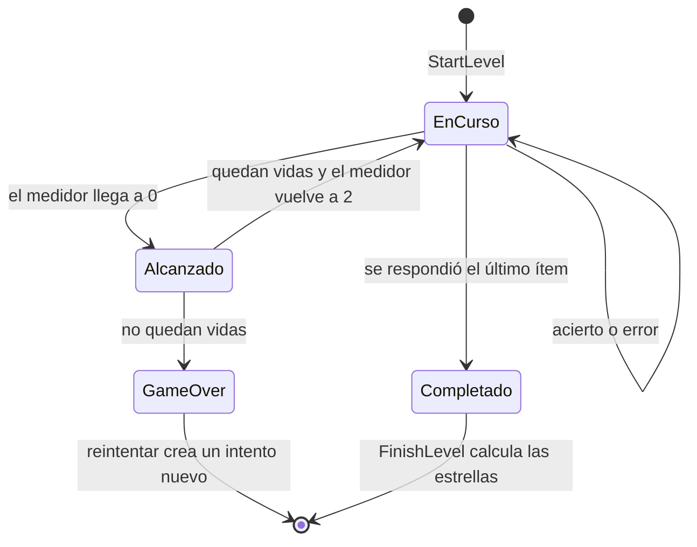
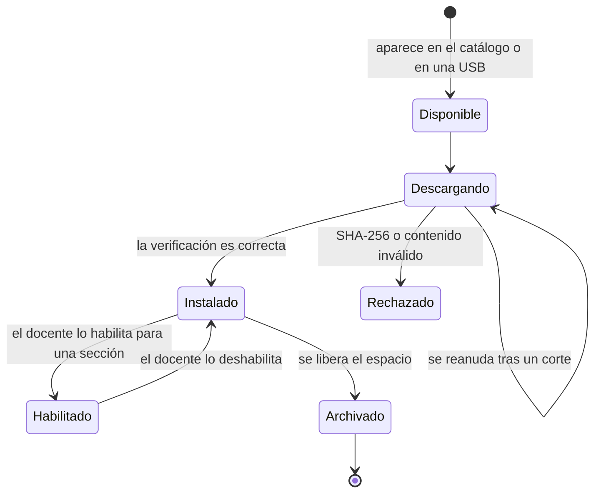

# Diseño interno de módulos

Componentes del juego con sus casos de uso, sus puertos y las reglas del dominio que usan. Los nombres están en inglés, como en el código.

## Componentes del juego

| Componente | Casos de uso | Reglas del dominio | Puertos |
| --- | --- | --- | --- |
| Aula e identidad | `ConfigureInstitution`, `GetClassroom`, `UnlockTeacherMode`, `RegisterStudent`, `UpdateStudent`, `SetStudentActive`, `ResetStudentPin`, `LoginStudent`, `ListStudents`, `GetStudentProfile`, `CustomizeAvatar`, `SuggestPin`, `SuggestAvatar` | `Pin`, `PinLockout` (bloqueo tras 5 fallos), `PersonName`, `TeacherCode`, `Avatar` | `InstitutionRepository`, `StudentRepository`, `PinHasher`, `Clock`, `IdGenerator`, `RandomSource` |
| Paquetes | `FetchCatalog`, `DownloadPackage`, `InstallPackage`, `ImportPackageFile`, `ReleasePackage`, `EnablePackage` | Validación del manifiesto y del contenido | `CatalogGateway`, `PackageDownloader`, `PackageArchive`, `PackageRepository`, `FileImporter` |
| Contenidos | `GetStopContent`, `OpenTheory`, `OpenReading` | `UnlockRule` (RN-18) | `PackageStore`, `ProgressRepository` |
| Juego | `StartLevel`, `SubmitAnswer`, `RequestHint`, `FinishLevel` | `LevelSession`, `DangerMeter`, evaluadores, `StarRule` | `PackageStore`, `AttemptRepository`, `LevelSessionStore`, `Clock`, `IdGenerator` |
| Desafío final | `StartFinalChallenge`, `AnswerFinalItem`, `SubmitFinalChallenge`, `AuthorizeExtraAttempt` | `FinalChallenge`, `CnebGradeScale`, límite de intentos | `AttemptRepository`, `SettingsRepository`, `Clock` |
| Recompensas | `GrantRewards`, `GetCollection` (los accesorios de RF-32 amplían `CustomizeAvatar`) | Umbrales de accesorios, condiciones de insignias | `RewardRepository`, `StudentRepository` |
| Reportes | `GetSectionReport`, `ExportReportCsv` | Agregados por estudiante, área y módulo | `AttemptRepository`, `ReportExporter` |
| Ajustes | `UpdateEvaluationSettings`, `UpdateAudioSettings` | Rangos válidos de la escala | `SettingsRepository` |

## Sesión de nivel

`LevelSession` es la entidad que aplica las reglas de un nivel de práctica (RN-11, RN-13 y RN-14). No conoce animaciones: devuelve un resultado que el presentador traduce para la escena.

Resultado de cada respuesta (`AnswerOutcome`): si fue correcta, la retroalimentación, el nuevo valor del medidor, las vidas restantes, si Atoq alcanzó al avatar y si el nivel terminó.

## Ciclo de vida de un paquete

Al archivar un paquete se borran sus archivos, pero se conservan sus intentos y resultados (RN-09).

## Motor de actividades

Cada tipo de ítem tiene un evaluador que implementa la misma interfaz (`ItemEvaluator`). `EvaluatorRegistry` elige el evaluador según el campo `type` del ítem. Agregar un tipo nuevo significa crear un evaluador y su componente visual, sin tocar `LevelSession`.

| Evaluador | Tipo de ítem | Regla |
| --- | --- | --- |
| `MultipleChoiceEvaluator` | `multiple_choice` | La opción elegida es la correcta |
| `MultiSelectEvaluator` | `multi_select` | El conjunto elegido es exactamente el correcto |
| `TrueFalseEvaluator` | `true_false` | Todas las afirmaciones bien respondidas |
| `OrderingEvaluator` | `ordering` | Secuencia idéntica |
| `MatchingEvaluator` | `matching` | Todos los pares correctos |
| `ClassificationEvaluator` | `classification` | Cada elemento en su grupo |
| `FillBlankEvaluator` | `fill_blank` | Cada espacio, con texto normalizado |
| `NumericEvaluator` | `numeric` | Valor dentro de la tolerancia y en un formato aceptado |
| `ShortTextEvaluator` | `short_text` | Coincide con una respuesta aceptada, sin distinguir mayúsculas ni tildes |
| `HotspotEvaluator` | `hotspot` | El toque cae en la zona correcta |
| `SentenceCheckEvaluator` | `sentence_check` | Sí o No coincide |
| `ReadingUnitEvaluator` | `reading_unit` | Evalúa cada ítem interno con su evaluador |

## Pruebas por capa

| Capa | Qué se prueba | Herramienta |
| --- | --- | --- |
| Dominio | Reglas: evaluadores, medidor, vidas, estrellas, escala CNEB y desbloqueo | GdUnit4, sin escenas |
| Aplicación | Casos de uso con puertos simulados (mocks) | GdUnit4 |
| Infraestructura | Repositorios SQLite, instalación de paquetes válidos y alterados | GdUnit4 con base temporal |
| Arquitectura | Regla de dependencias | Script en CI |
| Interfaz | Recorridos principales en la tablet real | Pruebas manuales guiadas |
