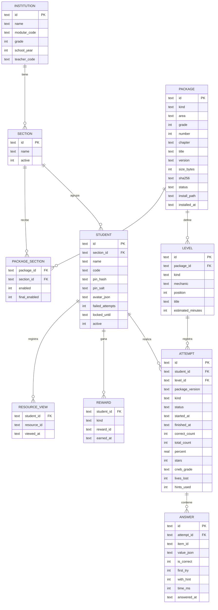
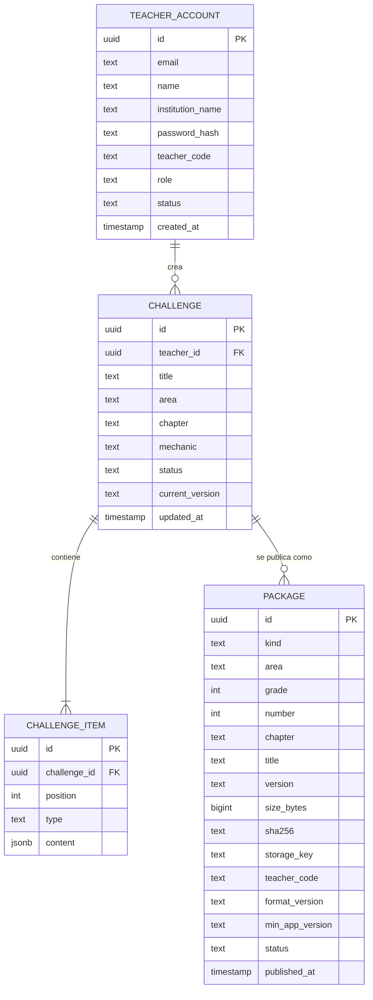

# Modelo de datos

Los nombres de tablas y columnas están en inglés, como el código. El contenido de los niveles (preguntas, textos e imágenes) no se copia a la base de datos: queda en los archivos del paquete instalado, y la base guarda un índice de niveles y los resultados.

## Tablet (SQLite)

Tablas adicionales: `teacher` (nombre, `pin_hash`, `pin_salt`, intentos fallidos y bloqueo), `setting` (clave y valor para la escala AD/A/B/C, los intentos, la pausa y el volumen) y `schema_migration` (versión del esquema).

### Valores permitidos

| Columna | Valores |
| --- | --- |
| `package.kind` | `module`, `challenge` |
| `package.area` | `math`, `language`, `science` |
| `package.chapter` | `sierra`, `selva`, `costa` |
| `package.status` | `installed`, `archived` |
| `level.kind` | `short`, `regular`, `final` |
| `level.mechanic` | `chase`, `bridge`, `classic` |
| `attempt.kind` | `practice`, `final` |
| `attempt.status` | `in_progress`, `completed`, `game_over`, `closed` |
| `attempt.cneb_grade` | `AD`, `A`, `B`, `C` (solo desafío final) |
| `reward.kind` | `badge`, `card`, `accessory` |

### Reglas de almacenamiento

- Cada respuesta se guarda en su propia transacción, con SQLite en modo WAL (RNF-06).
- Los identificadores de intentos y respuestas son UUID generados en la tablet.
- Las fechas se guardan en formato ISO 8601.
- El PIN se guarda como hash con sal; nunca en texto claro (RNF-08). El hash usa PBKDF2-HMAC-SHA256 y guarda el algoritmo y las iteraciones (`pbkdf2-sha256$4000$…`), así se pueden subir las iteraciones sin invalidar los PIN guardados. La sal son 16 bytes aleatorios en hexadecimal.
- `failed_attempts` y `locked_until` llevan el bloqueo temporal: con 5 fallos seguidos, el acceso se bloquea 5 minutos.
- `student.avatar_json` guarda los índices de los catálogos del avatar: `{"body": "girl", "skin": 2, "hair_style": 3, "hair_color": 0, "top_color": 1, "bottom_color": 4}`. Un `{}` significa que el estudiante todavía no creó su personaje. Los colores no se guardan: los decide la paleta del juego.
- Un estudiante con resultados se desactiva, no se elimina (RN-07).
- `level.id` identifica el nivel en toda la tablet como `paquete/nivel` (por ejemplo, `mod-math-6-00/L01`); así un intento siempre apunta a un nivel registrado. Los paquetes que vienen con el juego se registran al iniciar, con `install_path` en `res://content/packages/…`.
- `attempt.total_count` cuenta las preguntas del nivel (cada pregunta de una unidad de lectura por separado); `correct_count`, las acertadas al primer intento; `percent`, su porcentaje; y `stars`, las estrellas según RN-11. Un intento `in_progress` con respuestas se retoma al volver a abrir el nivel.
- `answer.value_json` guarda la respuesta tal como la dio el estudiante: el id de la opción (`"b"`), una lista de ids (selección múltiple y ordenar), un objeto (verdadero o falso, emparejar, clasificar y completar) o el texto escrito (respuesta numérica, por ejemplo `"0,5"`). `first_try` es 0 en el repaso de una pregunta fallada y `with_hint` indica si se vio la pista.

## Nube (PostgreSQL)

La nube **no tiene tablas de estudiantes, intentos ni calificaciones** (RN-08).

| Columna | Valores |
| --- | --- |
| `teacher_account.role` | `teacher`, `editor` |
| `challenge.status` | `draft`, `published`, `archived` |
| `package.kind` | `module` (oficial, sin `teacher_code`), `challenge` (con `teacher_code`) |
| `package.status` | `published`, `withdrawn` |
