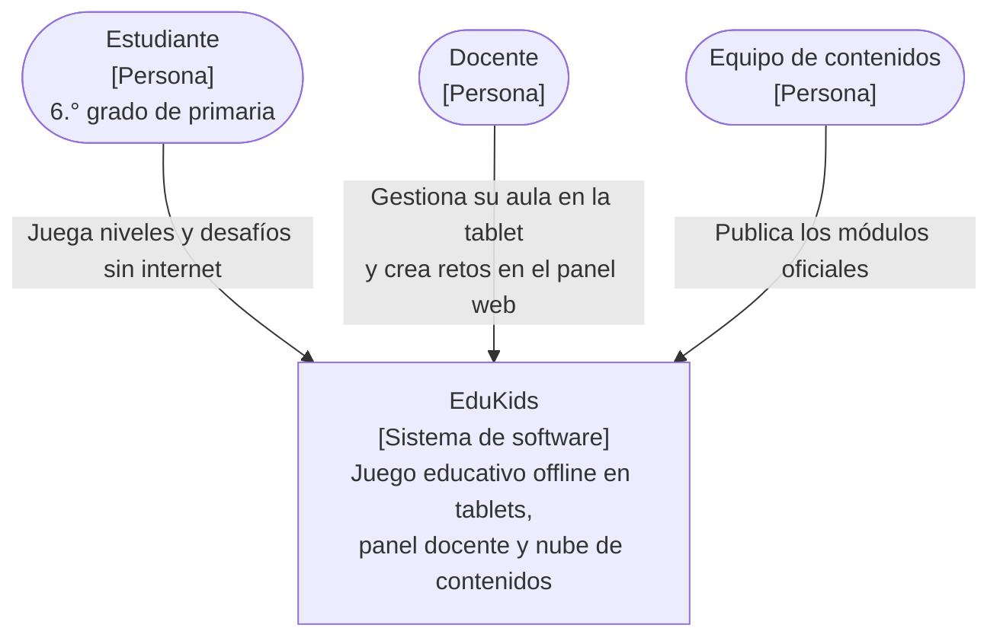

# C4 Nivel 1: Contexto

| Elemento | Descripción |
| --- | --- |
| Estudiante | Juega en la tablet con su avatar y su PIN. Solo ve su propio avance. |
| Docente | En la tablet configura el aula, habilita paquetes y revisa reportes. En el panel web crea y publica retos. |
| Equipo de contenidos | Produce y publica los módulos oficiales de las tres áreas desde el panel. |
| EduKids | Juego para Android que funciona sin internet en el aula, más la API y el panel que distribuyen y crean contenidos. |

**Límite de privacidad:** los resultados de los estudiantes no salen de la tablet. EduKids no se integra con sistemas externos como SIAGIE (fuera de alcance).
