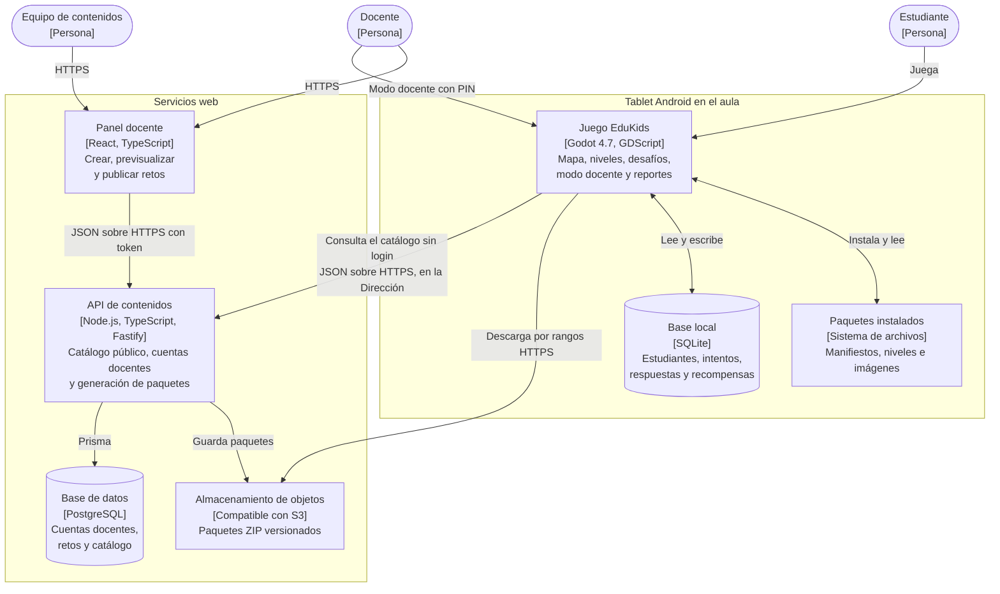

# C4 Nivel 2: Contenedores

| Contenedor | Tecnología | Responsabilidad | Estado |
| --- | --- | --- | --- |
| Juego EduKids | Godot 4.7, GDScript | Toda la experiencia del estudiante y del docente en el aula | Aceptada (ADR-009) |
| Base local | SQLite con godot-sqlite | Datos y resultados de los estudiantes | Aceptada (ADR-007) |
| Paquetes instalados | Archivos en el almacenamiento interno de la aplicación | Contenido de módulos y retos | Aceptada (ADR-013) |
| Panel docente | React, TypeScript y Vite | Crear y publicar retos; publicar módulos (editor) | Propuesta (ADR-017) |
| API de contenidos | Node.js, TypeScript y Fastify | Catálogo, cuentas docentes y empaquetado | Propuesta (ADR-017) |
| Base de datos | PostgreSQL | Cuentas docentes, retos y catálogo | Propuesta (ADR-017) |
| Almacenamiento de objetos | Compatible con S3 | Paquetes ZIP con descargas por rangos | Propuesta (ADR-017) |

**Reglas:** la tablet solo se conecta a la nube en la Dirección y nunca envía datos de estudiantes. Si la nube no está disponible, los paquetes se instalan por USB.
