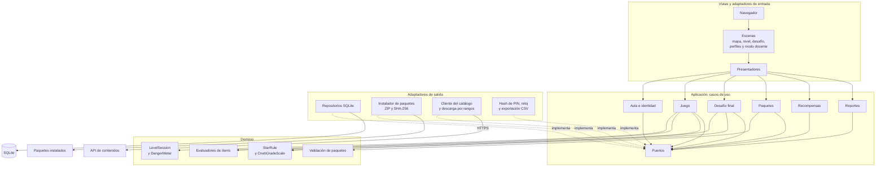
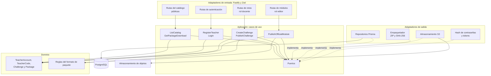

# C4 Nivel 3: Componentes

Los componentes se agrupan por capas de [Clean Architecture](../02-arquitectura-software/clean-architecture.md). Las flechas punteadas indican que un adaptador implementa un puerto.

## Juego EduKids

## API de contenidos

El panel docente sigue la misma organización con menos piezas (dominio del reto, casos de uso del panel, cliente de la API y componentes React); se detalla en [Clean Architecture](../02-arquitectura-software/clean-architecture.md).
