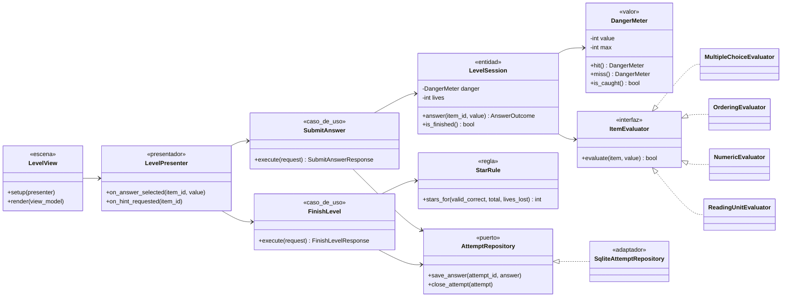

# C4 Nivel 4: Código (diseño propuesto)

Todavía no existe código, así que este diagrama es una **propuesta** para el motor de niveles. Muestra cómo se respeta la regla de dependencias: la escena depende del presentador, el presentador de los casos de uso, los casos de uso del dominio y de sus puertos, y el adaptador SQLite implementa el puerto.

| Clase | Capa | Carpeta |
| --- | --- | --- |
| `LevelView` | Vista (framework) | `scenes/level/` |
| `LevelPresenter` | Adaptador de entrada | `src/presentation/presenters/` |
| `SubmitAnswer`, `FinishLevel` | Aplicación | `src/application/use_cases/play/` |
| `AttemptRepository` | Aplicación (puerto) | `src/application/ports/` |
| `LevelSession`, `DangerMeter`, `StarRule` | Dominio | `src/domain/rules/` |
| `ItemEvaluator` y evaluadores | Dominio | `src/domain/evaluators/` |
| `SqliteAttemptRepository` | Adaptador de salida | `src/infrastructure/sqlite/` |

**Estado:** propuesta que se validará con el código del Sprint 4 y el Sprint 5.
