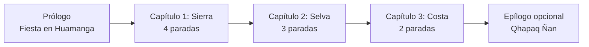
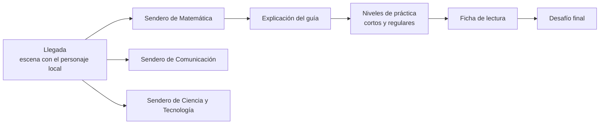

# 03. Capítulos y mapa

## Estructura del mundo

El **mapa general** muestra un Perú estilizado con Ayacucho al centro. Un capítulo se ilumina cuando el docente habilita alguno de sus módulos. La Sierra tiene más paradas porque es la región de la escuela piloto; Ayacucho también tiene selva, en el valle del río Apurímac, que es el escenario del segundo capítulo.

## Capítulo 1: Sierra, "Las alturas de Ayacucho"

| N.° | Parada | Ambiente | Elementos | Módulos |
| --- | --- | --- | --- | --- |
| 1 | Huamanga | Plaza, mercado y talleres de retablos | Retablos, piedra de Huamanga, fiesta del pueblo | MAT-01, COM-01, CYT-01 |
| 2 | Quinua | Pueblo de ceramistas y pampa histórica | Cerámica, hornos, tejidos | MAT-02, COM-02, CYT-02 |
| 3 | Pampa Galeras | Puna abierta con vicuñas | Chaccu, ichu, frío de la puna | MAT-03, COM-03, CYT-03 |
| 4 | Vilcashuamán | Sitio inca con templo y ushnu | Andenes, puertas trapezoidales, montañas | MAT-04, COM-04, CYT-04 |

- **Guía:** Quwi.
- **Paleta:** cielo azul intenso, ocres de la puna, terracota y adobe, con acentos textiles en magenta, naranja y turquesa.
- **Música:** quena, charango y percusión suave.

## Capítulo 2: Selva, "El valle del Apurímac"

| N.° | Parada | Ambiente | Elementos | Módulos |
| --- | --- | --- | --- | --- |
| 5 | Río Apurímac | Orillas, balsas y puerto fluvial | Corriente del río, peces, energía del agua | MAT-05, COM-05, CYT-05 |
| 6 | Chacra de cacao y café | Cultivos bajo la sombra de los árboles | Mazorcas de cacao, secado de granos, chocolate | MAT-06, COM-06, CYT-06 |
| 7 | Bosque de neblina | Bosque húmedo y nublado | Gallito de las rocas, orquídeas, cámaras trampa | MAT-07, COM-07, CYT-07 |

- **Guía:** Tunki.
- **Paleta:** verdes profundos y esmeralda, azul del río, lila de la neblina y el naranja intenso del gallito.
- **Música:** flautas, percusiones de madera y sonidos del bosque.

## Capítulo 3: Costa, "Del mar al desierto"

| N.° | Parada | Ambiente | Elementos | Módulos |
| --- | --- | --- | --- | --- |
| 8 | Islas y puerto | Islas guaneras, mar y muelle pesquero | Pingüinos, lobos marinos, botes, anchoveta | MAT-08, COM-08, CYT-08 |
| 9 | Desierto y líneas de Nasca | Pampa desértica con figuras gigantes | Líneas de Nasca, acueductos, huarangos, cielo nocturno | MAT-09, COM-09, CYT-09 |

- **Guía:** Humbi [POR CONFIRMAR].
- **Paleta:** arena y ocre del desierto, turquesa y azul profundo del mar, blanco de la espuma y naranja del atardecer.
- **Música:** guitarra, cajón y sonido de olas.

## Epílogo opcional: el Qhapaq Ñan

El camino inca une las tres regiones. Tiene niveles mixtos de repaso de todo el año y la escena final del quipu reconstruido. Prioridad P3.

## Estructura de una parada

Cada parada tiene **tres senderos**, uno por área, que se iluminan con el color del área:

Los tres senderos tienen la misma estructura; en el diagrama solo se desarrolla uno.

## La escuelita: retos del docente

En cada capítulo hay una **escuelita**, un edificio con bandera donde aparecen los retos que el docente descargó y habilitó. Los retos usan las mismas mecánicas y dan estrellas, pero no cuentan para el quipu.

## Reglas del mapa

- Lo que no está habilitado para la sección se ve con candado y el mensaje "Tu docente lo abrirá pronto" (RN-01).
- Dentro de un módulo, los niveles se desbloquean en orden; el desafío final se abre al completar los niveles de práctica o cuando el docente lo habilita (RN-18).
- Se llega a cualquier nivel habilitado en máximo tres toques desde el mapa general (RF-22).
- El avatar camina por el mapa hasta la parada elegida, con una animación breve que se puede saltar.
