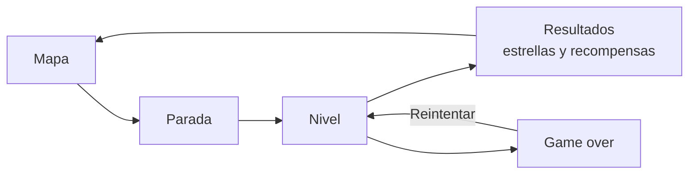

# 04. Mecánicas y actividades

## Bucle principal

## El medidor de peligro

Todas las mecánicas de práctica comparten una sola regla del dominio (RN-13 y RN-14). Así el juego es justo y coherente, y solo cambia la forma en que se ve.

- El medidor empieza en **2** y su máximo es **4**.
- Cada acierto suma 1; cada error resta 1.
- Si llega a **0**, se pierde una vida y el medidor vuelve a 2.
- Cada nivel empieza con **3 vidas**; con 0 vidas el nivel termina en game over y se puede reintentar de inmediato.
- Estos valores se pueden ajustar por nivel en el paquete.

| Respuesta | Medidor | Vidas | Qué se ve en la persecución |
| --- | --- | --- | --- |
| Inicio | 2 | 3 | Atoq corre a dos pasos |
| Acierto | 3 | 3 | El avatar acelera y se aleja |
| Error | 2 | 3 | Atoq se acerca un paso |
| Error | 1 | 3 | Atoq está a punto de alcanzarlo |
| Error | 0 → 2 | 2 | Atoq lo alcanza, se lleva un nudo y vuelve a empezar la carrera |

## Mecánicas

### Persecución

- **Fantasía:** escapar de Atoq por un camino de la región (sendero andino, orilla del río, playa).
- **Cómo funciona:** el avatar corre de forma automática; cada acierto lo hace avanzar o saltar un obstáculo y cada error acerca a Atoq. Al responder la última pregunta, el avatar llega a la meta y recupera el nudo.
- **Ideal para:** niveles cortos de práctica y fluidez (cálculo mental, "¿tiene sentido?", clasificar rápido).
- **Tiempo:** sin límite por defecto. En niveles de fluidez se puede activar `timer_seconds`: si pasa ese tiempo sin respuesta, Atoq avanza un paso. Nunca se activa en lecturas (RN-17).

### Puente

- **Fantasía:** construir un camino para cruzar un río, un barranco o un andén.
- **Cómo funciona:** cada acierto coloca una piedra o una tabla; cada error hace que el puente se tambalee (el medidor baja). En 0, el avatar cae al agua, pierde una vida y vuelve al inicio del tramo.
- **Ideal para:** niveles regulares con problemas de varios pasos y secuencias.

### Clásica

- **Fantasía:** sentarse con el guía a resolver tarjetas.
- **Cómo funciona:** las preguntas aparecen en tarjetas grandes; en la práctica, Atoq se asoma por un costado según el medidor.
- **Ideal para:** unidades de lectura, ítems con imágenes grandes y el desafío final.

## Desafío final

- Usa la mecánica clásica **sin medidor, sin vidas y sin game over** (RN-10).
- No muestra si cada respuesta es correcta; al terminar presenta la calificación AD, A, B o C, el porcentaje y la retroalimentación de cada pregunta.
- Tiene intentos limitados (por defecto, 2) y se guarda respuesta por respuesta (RNF-06).
- Al superarlo, Mama Sisa entrega la cuerda del área para el quipu.

## Tipos de actividad

Los tipos de ítem están definidos en [tipos de ítems y calificación](../06-contenidos-curriculares/07-tipos-de-items-y-calificacion.md). En el juego se ven así:

| Tipo | Interacción en el juego | Ejemplo |
| --- | --- | --- |
| Opción múltiple | Tocar una de 3 o 4 tarjetas | ¿Cuál es el valor de la cifra 5? |
| Selección múltiple | Marcar varias tarjetas y confirmar | Elige los alimentos ricos en hierro |
| Verdadero o falso | Deslizar cada afirmación a V o F | Afirmaciones sobre una noticia |
| Ordenar | Arrastrar tarjetas a una fila | Pasos del chaccu, fases de la Luna |
| Emparejar | Unir con una cuerda dos columnas | Fracción con su decimal |
| Clasificar | Arrastrar elementos a canastas | Primos y compuestos; renovable o no renovable |
| Completar | Arrastrar palabras a los espacios | Conectores en un texto |
| Respuesta numérica | Teclado numérico grande del juego | Litros que caben en el tanque |
| Respuesta breve | Teclado del juego con pocas letras | Nombre de una capa de la Tierra |
| Tocar en la imagen | Tocar la zona correcta de un dibujo | Partes de la célula, eje de simetría |
| ¿Tiene sentido? | Botones grandes Sí y No | Fluidez lectora |
| Unidad de lectura | Texto a la izquierda y preguntas a la derecha | Leyenda, infografía o experimento |

## Retroalimentación y pistas

- Cada respuesta tiene una reacción inmediata: animación del avatar, del guía y de Atoq, sonido y un mensaje de una o dos líneas.
- Si la respuesta es incorrecta, el guía explica por qué y la pregunta vuelve una vez al final del nivel (RF-29).
- El botón de pista está siempre visible; usar una pista no quita vidas, pero esa pregunta deja de contar como acierto válido para las estrellas (RN-11).
- Tras dos errores seguidos, el guía ofrece una pista sin que el estudiante la pida (RF-26).

## Progresión de dificultad en un módulo

| Niveles | Dificultad de los ítems | Mecánica sugerida |
| --- | --- | --- |
| 1 y 2 | Básica | Persecución (corto) |
| 3 a 5 | Básica e intermedia | Persecución o puente |
| 6 a 8 | Intermedia y avanzada | Puente o clásica con unidades de lectura |
| Desafío final | 30 % básica, 50 % intermedia y 20 % avanzada | Clásica sin medidor |

## Ayudas contra la frustración (P2)

Después de dos game over seguidos en el mismo nivel, el guía sugiere repasar la explicación y ofrece un **modo ayuda** para el siguiente intento: el medidor empieza en 3 y hay una pista extra. Ese intento puede ganar como máximo dos estrellas.
