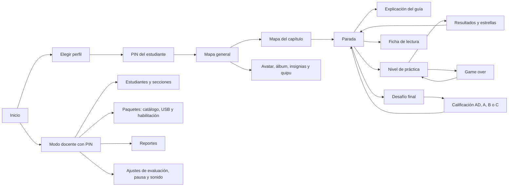

# 07. Interfaz y pantallas

## Flujo de pantallas



## Pantallas

| Pantalla | Elementos principales | Notas |
| --- | --- | --- |
| Inicio | Logo, botón Jugar y acceso discreto al modo docente | La primera vez abre la configuración inicial |
| Elegir perfil | Avatares grandes con el nombre de cada estudiante, filtrados por sección | Desplazamiento horizontal |
| PIN | Teclado numérico grande de 4 dígitos | Bloqueo temporal tras 5 fallos |
| Mapa general | Capítulos con su estado; botón de colección | Capítulos sin contenido habilitado aparecen apagados |
| Mapa del capítulo | Paradas, escuelita y caminos | Animación breve del avatar al elegir una parada. Hoy es el inicio del estudiante: las paradas son medallones ilustrados (retablo, cerámica, vicuña y ushnu) unidos por el Qhapaq Ñan, con candado si no tienen contenido |
| Parada | Escena del lugar, personaje local y tres senderos | Cada sendero es una cuerda del quipu en el color del área, con un nudo por nivel (icono de su mecánica, número, estrellas o calificación, candado si está cerrado) y el desafío final al final. El nudo sugerido late con una flecha. Al tocar un nudo se abre su ficha con «¡Jugar!» |
| Nivel | Escena de la mecánica, pregunta y respuestas | Ver la disposición de la pantalla |
| Resultados | Estrellas animadas, aciertos y recompensas | Botones Seguir y Repetir |
| Game over | Atoq con la bolsa de nudos y mensaje de ánimo | Botones Reintentar y Volver a la parada |
| Desafío final | Portada con intentos disponibles, preguntas y confirmación de entrega | Al final: calificación, porcentaje y retroalimentación |
| Ficha | Visor de páginas con zoom y desplazamiento | Sin conexión |
| Colección | Avatar y accesorios, álbum de cartas, insignias y quipu | Lo bloqueado indica qué falta para obtenerlo |
| Modo docente | Pestañas: Estudiantes, Paquetes, Habilitar, Reportes y Ajustes | Se cierra solo tras unos minutos sin uso |

## Pantalla de un nivel

```text
┌────────────────────────────────────────────────────────────────┐
│ Vidas ♥ ♥ ♥        Medidor de peligro ■ ■ □ □       3 / 8   [II] │
│                                                                │
│        Escena: el avatar corre, Atoq lo persigue,              │
│        el guía observa desde una esquina                       │
│                                                                │
│ ┌────────────────────────────────────────────────────────────┐ │
│ │ Enunciado de la pregunta                                   │ │
│ │                                                            │ │
│ │  [ Opción A ]   [ Opción B ]   [ Opción C ]   [ Opción D ] │ │
│ └────────────────────────────────────────────────────────────┘ │
│                                                     [ Pista ]  │
└────────────────────────────────────────────────────────────────┘
```

- Arriba a la izquierda: vidas. Al centro: medidor de peligro. A la derecha: avance y pausa.
- En la persecución, el puente y el caimán, la escena de la mecánica ocupa una franja de 212 px arriba y la tarjeta de la pregunta, el resto. En la mecánica clásica no hay franja: las vidas y el medidor van en la columna de Quwi y Atoq se asoma por el borde derecho de la tarjeta. Al terminar, la franja se acerca y la tarjeta se desvanece para el final feliz.
- El medidor de peligro llena sus segmentos con un solo color según el riesgo (verde, amarillo, naranja y rojo) y muestra quién acecha: Atoq, Coco o el río. Las vidas son corazones que se parten al perder una.
- El avance es un quipu con un nudo por pregunta: verde si acertó, coral si volverá al final, dorado si la corrigió en el repaso y gris si no salió; la pregunta actual brilla con el color del área.
- Al comprobar, cada parte respondida se marca con ✓ o ✗ y la retroalimentación sube desde abajo con el botón Seguir. El guía da la pista en un globo.
- La pregunta ocupa la mitad inferior; la escena, la superior.
- En las unidades de lectura, el texto ocupa la mitad izquierda y las preguntas la derecha.

## Reglas de interfaz

- Orientación horizontal; resolución base de 1280 × 800.
- Botones de al menos 56 dp (recomendado 64 dp) con separación suficiente para dedos pequeños.
- Cada botón combina icono y texto; nunca solo icono en acciones importantes.
- Tipografía legible: preguntas de 28 px, textos de lectura de 26 px y ningún texto menor de 20 px (en la resolución base).
- Líneas de lectura de 60 caracteres como máximo.
- Cada área se reconoce por su color **y** por su icono: nudos para Matemática, libro para Comunicación y hoja con lupa para Ciencia y Tecnología.
- La reacción a un toque empieza en menos de 100 ms (RNF-02).
- Máximo tres toques desde el mapa general hasta cualquier nivel (RF-22).

## Accesibilidad

- Contraste WCAG AA en textos e iconos (RNF-11).
- Ninguna información depende solo del color: los aciertos y errores también usan forma, icono y animación.
- Tamaño de texto ajustable en los ajustes (P2).
- Opción para reducir el movimiento de las animaciones (P3).
- Como no hay voces, las instrucciones son breves y se acompañan de una demostración animada la primera vez.
